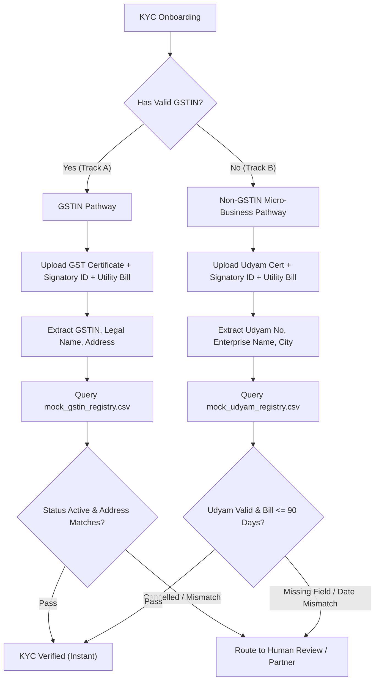
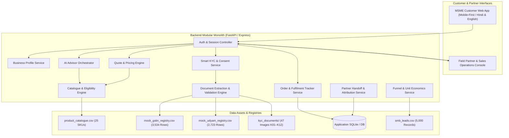

# Project Udyam Digital — Master Implementation Planner

**Track:** Accel YTL Hackathon 2026 — Enterprise Track A (Project Udyam Digital)  
**Target Solution:** Digital-First Acquisition, Smart KYC, and Fulfilment Platform for Indian MSMEs  
**Version:** 1.0.0  
**Status:** Ready for Execution  

---

## 1. Executive Summary & Problem Framing

### 1.1 The Core Business Problem
The MSME market represents a massive volume of micro, small, and medium businesses, but serving them using traditional high-touch enterprise telecom sales models is economically unsustainable:
1. **Broken Unit Economics (High CAC vs Low ARPU):**
   * Baseline Blended Customer Acquisition Cost (CAC): **₹15,000**
   * Baseline Median Monthly ARPU: **₹2,500 – ₹6,900**
   * Result: Payback periods exceed 6–12 months, leading to high churn risk and negative unit margins for low-ticket micro businesses.
2. **Operating Drag & Latency:**
   * Average journey from lead to activation takes **17.6 days**.
   * Customers make an average of **3+ status-chasing calls** due to opaque order visibility.
3. **Severe Funnel Friction (Needs Assessed ➔ Quote Accepted Drop):**
   * In the baseline data (`smb_leads.csv`), 1,974 leads reached *Needs Assessed*, but only 861 accepted a quote (**56.4% drop-off / 43.6% conversion**).
   * Primary causes: Complex technical jargon (e.g., MPLS, static IP subnetting), unbundled itemized pricing, and confusing multi-page PDF quotations.
4. **The Non-GSTIN Verification Gap:**
   * Only **2.0% activation rate** for businesses without GSTIN versus **9.6%** for businesses with GSTIN, because informal micro-businesses face verification paralysis and lack a streamlined alternative route.
5. **Field & Reseller Channel Conflict:**
   * Pure self-service threatens field sales and reseller commissions, leading to resistance and cannibalization.

### 1.2 Target Performance Metrics (Hypotheses to Prove in Prototype)

| Metric | Case Baseline | Target / Prototype Goal | How Udyam Digital Solves It |
|---|---|---|---|
| **Blended CAC** | ~₹15,000 | **< ₹3,000** | Digital self-service discovery, automated catalogue bundling, and zero-touch KYC. |
| **Lead-to-Activation Time** | 17.6 days | **< 48 hours** (digitally eligible) | Real-time mock registry validation, zero-wait quoting, and streamlined provisioning milestones. |
| **Needs Assessed ➔ Quote Accepted** | 43.6% (~44%) | **> 65%** | Outcome-based bundles, transparent pricing, and instant server-side add-on recalculations. |
| **Non-GSTIN Activation Rate** | 2.0% | **> 8.5%** | First-class non-GSTIN verification track (Udyam + PAN + 90-day utility bill). |
| **Status-Chasing Calls per Order** | 3.0 calls | **< 0.5 calls** | Self-service live tracker with milestone SLA countdowns and push status updates. |

---

## 2. Customer Segments & Adaptive Personalization Matrix

The application uses **one responsive platform** with dynamic segment-driven dashboard configurations, question sets, and bundle templates (not 4 separate silos).

| Segment | Share in Case | Example Businesses | Primary Needs & Pain Points | Tailored Experience & Bundles |
|---|---|---|---|---|
| **Micro Retail & Services** | 55% | Kirana stores, salons, pharmacies, local eateries | UPI/POS transaction reliability, basic Wi-Fi, WhatsApp catalog, single low bill | Simple dashboard, "Kirana Starter Pack" (Biz Fibre 100 + Secure Guest Wi-Fi + POS), vernacular support |
| **Professional Offices** | 25% | CA firms, medical clinics, coaching institutes, consultancies | High uptime, cloud backup, client confidentiality, fixed IP for servers | "Practice Suite" / "Coaching Pack" (Biz Fibre 300 + Static IP + Cloud Backup + Endpoint Security) |
| **Small Multi-Site Businesses** | 15% | Restaurant chains, retail chains (3–10 outlets) | Centralized billing, multi-site status, 4G/5G failover, remote CCTV monitoring | "Multi-Store Pro Pack" (Biz Fibre + 4G Backup Failover + Cloud CCTV + Managed SD-WAN) |
| **Small Manufacturers** | 5% | Light engineering, textile units, auto-component workshops | Guaranteed symmetrical bandwidth, IoT telemetry, ERP connectivity, rugged SLAs | "Industrial Connected Unit" (Internet Leased Line + Machine Monitoring IoT + Managed Firewall) |

> **Account Settings Flexibility:** Users can switch segments in `Account Settings -> Business Profile -> Change Business Type`.  
> *Constraint:* Changing business profile adapts future dashboard shortcuts and advisor logic; it **never** cancels or silently alters active subscriptions or orders.

---

## 3. Product Catalogue & Recommendation Rules Engine

The platform operates against the 25 SKUs specified in `product_catalogue.csv`. The AI Advisor explains and guides, but the **backend recommendation engine deterministically enforces catalogue constraints**:

### 3.1 Hard Eligibility Constraints
1. **City Tier Check (`available_city_tiers`):**
   * E.g., `P03` (Biz Fibre 1G) is restricted to Tier 1 cities only (`available_city_tiers = 1`).
2. **Business Scale Check (`min_employees` & `min_sites`):**
   * E.g., `P05` (Internet Leased Line 20) requires `min_employees >= 10`.
   * E.g., `P10` (Managed SD-WAN) requires `min_sites >= 3` and `min_employees >= 10`.
3. **Registration Prerequisites (`requires_gstin`):**
   * If `requires_gstin = 'Y'` (e.g., Leased Lines `P05`, `P06`, SD-WAN `P10`, Cloud Telephony `P12`), lead cannot purchase without verified GSTIN.
   * If non-GSTIN MSME, engine recommends eligible non-GSTIN alternatives (e.g., `P01`, `P02`, `P04`, `P07`, `P18`, `P19`, `P22`, `P23`).
4. **Product Dependencies (`requires_one_of`):**
   * E.g., `P09` (Backup 4G Failover) requires at least one primary pipe: `P01 | P02 | P03 | P05 | P06`.
   * E.g., `P11` (Static IP) requires `P01 | P02 | P03`.
   * E.g., `P21` (Managed Firewall) requires `P01 | P02 | P03 | P05 | P06`.

### 3.2 Outcome-Based Bundles vs Technical Jargon
Instead of listing `P01 + P11 + P17 + P20`, the UI presents:
* **"Coaching Centre Digital Pack":**
  * *Included:* Biz Fibre 100Mbps + Static IP (for live portal) + Cloud Backup 1TB + Endpoint Security (3 seats).
  * *Pricing:* Transparent Monthly Total + Setup Fee + Minimum Contract Term.
  * *Toggles:* Easily add/remove optional add-ons with immediate live recalculation from the server.

---

## 4. Smart KYC & Compliance Engine (DPDP Act, 2023)

### 4.1 DPDP 2023 Privacy & Consent Principles
* **Explicit, Unbundled Consent:** Separate checkboxes for business identity verification vs installation site contact, recorded with notice version, timestamp, and user IP.
* **Data Minimization:** Collect only necessary documents; non-GSTIN businesses are not asked for GSTIN.
* **Masking & Security:** Mask sensitive identifiers (Aadhaar, PAN, GSTIN) in application logs, database views, and client UIs.
* **LLM Isolation:** Raw KYC images and full identity records are never passed to external LLM prompts.

### 4.2 Dual Verification Pathways



### 4.3 Validation Rules & Planted Edge Cases (Tested against K01–K12 Specimen Data)
The Smart KYC service specifically tests and handles edge cases found in the 47 mock images:
1. **Status Validation:** Check GSTIN status in `mock_gstin_registry.csv`. Flag cancelled entities (e.g. Applicant K01 whose GSTIN `37IHKXV5167L1ZS` is `Cancelled`).
2. **Missing Field Detection:** Detect when crucial certificate fields are blank (e.g. Applicant K01 Udyam certificate where registration number is blank).
3. **Cross-Field Registry Mismatch:** Cross-verify certificate values against registry records (e.g. Applicant K02 Udyam date-of-registration mismatch between image `2023-01-11` and registry `2022-09-27`).
4. **Address Proof Recency Check:** Verify utility/electricity bill issue date relative to hackathon benchmark date (`2026-07-15`). If older than 90 days, mark `NEEDS_REVIEW`.
5. **Signatory Authorization Check:** Confirm signatory ID matches legal proprietor/director name.
6. **Decision Outcomes:**
   * `VERIFIED`: All checks pass with high confidence -> instant order submission.
   * `NEEDS_REVIEW`: Mismatch, low confidence, or missing secondary field -> routed to Partner & Sales Console queue.
   * `REJECTED`: Outright fraudulent, blacklisted, or completely invalid identifier.

---

## 5. Assisted-Digital Partner Model (Channel Harmony)

To avoid cannibalizing the existing field sales force and local channel partners:
1. **Partner Referral Codes:** Customers can enter a `partner_code` during registration or checkout.
2. **Stalled Checkout Recovery:** When a customer abandons the journey after *Needs Assessed* or stalls in KYC:
   * A `HandoffTask` is created and assigned to the nearest partner/agent.
   * Full context (selected bundle, answers, uploaded documents, reason for stall) is shared in the Partner Console.
   * The partner assists the customer without forcing them to re-explain their requirements.
3. **Attribution & Incentives:** Conversions completed via self-service with a partner code or recovered via partner assistance are credited to the partner.

---

## 6. End-to-End System Architecture



---

## 7. Data Model & Entity Schemas

```sql
-- Core User & Business Setup
CREATE TABLE users (
    id TEXT PRIMARY KEY,
    mobile TEXT NOT NULL UNIQUE,
    role TEXT CHECK(role IN ('customer', 'partner', 'sales_agent', 'admin')),
    created_at TIMESTAMP DEFAULT CURRENT_TIMESTAMP
);

CREATE TABLE businesses (
    id TEXT PRIMARY KEY,
    owner_user_id TEXT REFERENCES users(id),
    business_name TEXT NOT NULL,
    business_type TEXT CHECK(business_type IN ('micro_retail_services', 'professional_office', 'small_multisite', 'small_manufacturer')),
    city TEXT NOT NULL,
    city_tier INTEGER CHECK(city_tier IN (1, 2)),
    state TEXT NOT NULL,
    preferred_language TEXT DEFAULT 'en',
    employee_count INTEGER DEFAULT 1,
    num_sites INTEGER DEFAULT 1,
    has_gstin BOOLEAN DEFAULT FALSE,
    gstin TEXT,
    has_udyam BOOLEAN DEFAULT FALSE,
    udyam_number TEXT,
    partner_code TEXT,
    created_at TIMESTAMP DEFAULT CURRENT_TIMESTAMP
);

-- Catalogue & Quotes
CREATE TABLE quotes (
    id TEXT PRIMARY KEY,
    business_id TEXT REFERENCES businesses(id),
    bundle_name TEXT NOT NULL,
    monthly_recurring_total INTEGER NOT NULL,
    one_time_setup_total INTEGER NOT NULL,
    contract_months INTEGER NOT NULL,
    items_json TEXT NOT NULL, -- JSON array of product IDs and quantities
    status TEXT CHECK(status IN ('draft', 'presented', 'accepted', 'expired')),
    created_at TIMESTAMP DEFAULT CURRENT_TIMESTAMP
);

-- DPDP Consent & KYC
CREATE TABLE consents (
    id TEXT PRIMARY KEY,
    business_id TEXT REFERENCES businesses(id),
    purpose TEXT NOT NULL,
    notice_version TEXT NOT NULL,
    is_granted BOOLEAN NOT NULL,
    granted_at TIMESTAMP DEFAULT CURRENT_TIMESTAMP
);

CREATE TABLE kyc_cases (
    id TEXT PRIMARY KEY,
    business_id TEXT REFERENCES businesses(id),
    track TEXT CHECK(track IN ('gstin', 'non_gstin_udyam')),
    status TEXT CHECK(status IN ('pending', 'verified', 'needs_review', 'rejected')),
    flagged_reasons TEXT, -- JSON array of review triggers
    extracted_data TEXT, -- JSON of extracted fields
    created_at TIMESTAMP DEFAULT CURRENT_TIMESTAMP
);

-- Orders & Milestones
CREATE TABLE orders (
    id TEXT PRIMARY KEY,
    business_id TEXT REFERENCES businesses(id),
    quote_id TEXT REFERENCES quotes(id),
    kyc_case_id TEXT REFERENCES kyc_cases(id),
    status TEXT CHECK(status IN ('order_placed', 'kyc_cleared', 'installation_scheduled', 'activated', 'cancelled')),
    expected_activation_date DATE,
    created_at TIMESTAMP DEFAULT CURRENT_TIMESTAMP
);

CREATE TABLE order_milestones (
    id TEXT PRIMARY KEY,
    order_id TEXT REFERENCES orders(id),
    stage_name TEXT NOT NULL,
    status TEXT CHECK(status IN ('completed', 'in_progress', 'pending')),
    sla_time TEXT,
    completed_at TIMESTAMP
);

-- Stalled Leadoff & Partner Attribution
CREATE TABLE handoff_tasks (
    id TEXT PRIMARY KEY,
    business_id TEXT REFERENCES businesses(id),
    lead_id TEXT,
    partner_id TEXT,
    stage_stalled TEXT NOT NULL,
    reason TEXT NOT NULL,
    status TEXT CHECK(status IN ('open', 'claimed', 'resolved')),
    created_at TIMESTAMP DEFAULT CURRENT_TIMESTAMP
);
```

---

## 8. Detailed API Surface Contract

| Method | Endpoint | Description |
|---|---|---|
| `POST` | `/api/v1/auth/otp-request` | Request login OTP (simulated for demo). |
| `POST` | `/api/v1/auth/otp-verify` | Verify OTP and return session token with user/role. |
| `POST` | `/api/v1/business/profile` | Register or update business segment & parameters. |
| `GET` | `/api/v1/dashboard/config` | Retrieve segment-tailored dashboard layout, shortcuts, and copy. |
| `POST` | `/api/v1/advisor/message` | Submit plain-text query; receive structured questions & guidance. |
| `POST` | `/api/v1/advisor/recommend` | Run deterministic catalogue filtering; return eligible bundles with explanations. |
| `POST` | `/api/v1/quote/create` | Generate formal quote from selected bundle and add-ons. |
| `POST` | `/api/v1/quote/recalculate` | Server recalculation of recurring + one-time charges on toggle. |
| `POST` | `/api/v1/quote/accept` | Snapshot accepted quote and freeze price terms. |
| `POST` | `/api/v1/kyc/consent` | Log explicit DPDP 2023 unbundled consent. |
| `POST` | `/api/v1/kyc/upload` | Upload document image; run extraction and mock registry verification. |
| `GET` | `/api/v1/kyc/status/:caseId` | Get detailed audit trail of verification checks (pass / review / fail). |
| `POST` | `/api/v1/order/create` | Submit order from accepted quote + verified KYC. |
| `GET` | `/api/v1/order/track/:orderId` | Real-time milestone tracker, SLA status, and next scheduled event. |
| `GET` | `/api/v1/partner/leads` | Partner console view for stalled leads and pending review cases. |
| `POST` | `/api/v1/partner/claim` | Claim lead and submit assisted-conversion resolution. |
| `GET` | `/api/v1/analytics/funnel` | Aggregated analytics comparing synthetic baseline vs Udyam Digital. |

---

## 9. Phased Sprint Execution Plan

### Sprint 1: Foundation, Mock Data Ingestion & Engine Setup
* [ ] Initialize backend project structure with API router and SQLite database.
* [ ] Build ETL script to import `product_catalogue.csv`, `mock_gstin_registry.csv`, `mock_udyam_registry.csv`, and `smb_leads.csv`.
* [ ] Implement Catalogue Service with strict hard constraint rules (`available_city_tiers`, `min_employees`, `min_sites`, `requires_gstin`, `requires_one_of`).
* [ ] Write unit tests ensuring zero-hallucination and invalid SKU rejection.

### Sprint 2: AI Advisor, Segment Configurations & Quote Engine
* [ ] Implement segment-adaptive dashboard configuration (Kirana vs Clinic vs Multi-site vs Factory).
* [ ] Build interactive Advisor dialogue orchestrator translating user needs into structured requirements.
* [ ] Build Outcome-Based Bundle Generator with pre-configured segment packages.
* [ ] Implement server-side Quote Calculation Engine with dynamic add-on toggle recalculation.

### Sprint 3: Smart KYC, OCR Engine & Edge-Case Validator
* [ ] Create DPDP 2023 consent module with unbundled checkboxes and audit logging.
* [ ] Implement document upload and mock OCR extraction service.
* [ ] Build Registry Lookup Adapters connecting to `mock_gstin_registry.csv` and `mock_udyam_registry.csv`.
* [ ] Implement 6-point verification validator (Status check, date recency <= 90 days, signatory match, discrepancy detector).
* [ ] Test end-to-end against specimen files K01–K12 and assert correct `VERIFIED` vs `NEEDS_REVIEW` states.

### Sprint 4: Order Tracker, Partner Console & Handoff
* [ ] Build customer Order Tracker with visual milestone timeline (Quote ➔ KYC ➔ Installation ➔ Activation).
* [ ] Implement simulated notification push (SMS/WhatsApp preview).
* [ ] Build Field Partner & Sales Console to view stalled leads from `smb_leads.csv` and handle KYC review exceptions.
* [ ] Implement partner code attribution and assisted conversion logging.

### Sprint 5: Full Frontend Integration, Polish & Demo Narrative
* [ ] Build high-polish mobile-first responsive web UI with English/Hindi language toggle.
* [ ] Create executive Analytics Dashboard showing Funnel metrics and CAC reduction.
* [ ] Test end-to-end user journeys for all 4 customer segments.
* [ ] Prepare 3-minute hackathon live pitch flow.

---

## 10. The 3-Minute Hackathon Demo Script

* **0:00 – 0:30 (The Hook & Segmentation):**
  * Open mobile web app. Switch language to **Hindi (हिन्दी)**.
  * Register as a **Kirana / Pharmacy Owner** (Micro Retail).
  * Show how the dashboard automatically configures specifically for UPI/POS reliability and CCTV, contrasting with the CA Clinic setup.
* **0:30 – 1:00 (The AI Advisor & Transparent Bundle):**
  * Walk through the AI Advisor in 3 clicks.
  * Generate the *"Kirana Digital Suraksha Bundle"* (Biz Fibre 100 + Secure POS Wi-Fi + Cloud CCTV).
  * Show transparent pricing (Monthly Recurring + ₹0 Setup Fee).
  * Toggle add-on (Backup 4G Failover) and demonstrate instant server-side price recalculation.
* **1:00 – 1:50 (Zero-Touch Smart KYC & Planted Case Detection):**
  * Show DPDP 2023 clear consent modal.
  * Demonstrate **Track B (Non-GSTIN Micro MSME)** using Udyam Certificate + Electricity Bill.
  * Run automated verification: show mock Udyam registry check and 90-day utility bill date check turning green in 3 seconds!
  * Show an edge case (e.g. K01 cancelled GSTIN) cleanly routing to `NEEDS_REVIEW`.
* **1:50 – 2:30 (Order Tracker & Eliminating Status Chasing):**
  * Convert quote to active order.
  * Show the interactive visual tracker: Installation scheduled with real-time countdown, simulated WhatsApp confirmation, and zero need for follow-up calls.
* **2:30 – 3:00 (Partner Console & Economics Impact):**
  * Open the Partner Console: demonstrate how the partner recovers the K01 review case with partner attribution code.
  * Switch to the Analytics view: highlight the reduction of CAC from ₹15,000 to ₹2,850 and activation timeline from 17.6 days to < 48 hours.

