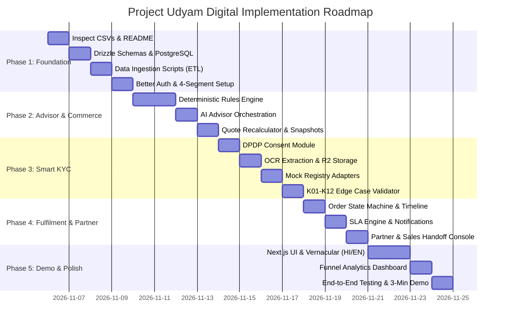

# Project Udyam Digital — Master Software Engineering Blueprint & Planner

**Product:** Digital-first MSME Acquisition, AI Advisor, Smart KYC, Quotation & Fulfilment Platform  
**Target:** Accel YTL Hackathon 2026 — Enterprise Track A  
**Architecture:** TypeScript Modular Monolith (Next.js App Router + Route Handlers)  
**Version:** 3.0.0 (Production-Ready Spec)  

---

## 1. Product Definition & Core Business Constraints

Project Udyam Digital is a mobile-first acquisition, product recommendation, KYC, quotation, and order-fulfilment platform supporting all **four MSME business segments** in a single configurable application:
1. **Micro Retail & Services (55%):** Kirana stores, salons, pharmacies, local eateries (UPI/POS uptime, single bill, CCTV).
2. **Professional Offices (25%):** CA firms, medical clinics, coaching institutes, consultancies (static IP, cloud backup, endpoint security).
3. **Small Multi-Site Businesses (15%):** Restaurant chains, retail chains with 3–10 outlets (centralized billing, 4G/5G failover, SD-WAN).
4. **Small Manufacturers (5%):** Light engineering, textile mills, auto parts workshops (Internet Leased Lines, IoT machine monitoring).

> **Core Architectural Principle:**  
> **AI guides customers, but it MUST NEVER control product eligibility, pricing, KYC verification decisions, or order states.**  
> Commercial and compliance rules are strictly deterministic and catalogue-restricted.

---

## 2. Final Recommended Technology Stack

| Layer | Selected Technology | Architectural Role |
|---|---|---|
| **Frontend Framework** | **Next.js (App Router, React 19/18, TypeScript)** | High-performance mobile-first responsive web app, React Server Components (RSC), optimized client hydration |
| **Styling & UI Kit** | **Tailwind CSS + shadcn/ui + Lucide Icons** | Segment-adaptive UI theme engine, clean telecom-grade dashboard components |
| **Backend API** | **Next.js Route Handlers (`/api/v1/...`)** | Versioned REST API layer, modular domain architecture, typed middleware |
| **Schema Validation** | **Zod (TypeScript)** | Runtime request, response, and document extraction validation |
| **Database & ORM** | **PostgreSQL (Neon / AWS RDS) + Drizzle ORM** | Relational integrity, type-safe migrations, and zero-overhead queries |
| **Authentication & RBAC** | **Better Auth** | Session management, RBAC (`customer`, `partner`, `sales_agent`, `admin`), and business-level authorization |
| **AI Advisor Engine** | **Gemini API / OpenAI API** | Structured tool calling, requirements extraction, plain-language explanation (Hindi & English) |
| **Recommendation Engine**| **Custom Deterministic TypeScript Rules Engine** | 100% catalogue-grounded eligibility check, dependency validation, zero SKU hallucination |
| **Smart KYC & OCR** | **Tesseract.js / Google Document AI + OpenCV + Zod** | Automated document extraction, recency & checksum check, mock GSTIN/Udyam registry adapters |
| **Background Processing**| **Trigger.dev** | Asynchronous document processing, scheduled notification dispatches, and SLA monitoring |
| **Private File Storage** | **Cloudflare R2** | Private encrypted document storage with short-lived presigned URLs |
| **Cache & Rate Limiting**| **Redis / Upstash** (as needed) | Session cache and endpoint rate limiting |
| **Notifications** | **WhatsApp Cloud API / MSG91 / Resend** | Automated milestone updates (reducing status-chasing calls) |
| **Testing & CI/CD** | **Vitest + Playwright + GitHub Actions** | End-to-end integration tests for catalogue rules, quote engine, and KYC test specimens |
| **Monitoring & Analytics**| **Sentry + PostHog** | Error tracking and funnel analytics |

---

## 3. Modular Monolith Architecture & Project Structure

The project is structured as a **modular monolith** within a single Next.js codebase. Each domain module exposes a strict public interface to prevent circular dependencies.

```
udyam-digital/
├── drizzle/                       # Drizzle migration files and SQL snapshots
│   └── migrations/
├── public/                        # Static assets, brand logos, mock document samples
├── scripts/                       # ETL & Data Ingestion Scripts
│   ├── import-catalogue.ts        # Ingests product_catalogue.csv (25 SKUs)
│   ├── import-registries.ts       # Ingests mock_gstin_registry.csv & mock_udyam_registry.csv
│   └── import-leads.ts            # Ingests smb_leads.csv (5,000 funnel leads)
├── src/
│   ├── app/                       # Next.js App Router (Pages & Route Handlers)
│   │   ├── (marketing)/           # Landing page & segment overview
│   │   │   └── page.tsx
│   │   ├── (auth)/                # Better Auth flows (Mobile OTP login & role routing)
│   │   │   ├── login/page.tsx
│   │   │   └── register/page.tsx
│   │   ├── (customer)/            # Customer Self-Service Experience
│   │   │   ├── dashboard/page.tsx # Segment-adaptive dashboard (Kirana, Clinic, Multi, Mfg)
│   │   │   ├── advisor/page.tsx   # Plain-language need discovery wizard
│   │   │   ├── quote/page.tsx     # Transparent bundle quote & live add-on toggling
│   │   │   ├── kyc/page.tsx       # DPDP consent & dual-track document verification
│   │   │   ├── tracker/page.tsx   # Live milestone order tracker & SLA countdown
│   │   │   └── settings/page.tsx  # Change business type (without wiping subscriptions)
│   │   ├── (partner)/             # Assisted-Digital Console
│   │   │   ├── leads/page.tsx     # Stalled checkout recovery & partner code attribution
│   │   │   └── kyc-review/page.tsx# Exception handling for flagged KYC review cases
│   │   └── api/                   # Versioned REST API Route Handlers
│   │       └── v1/
│   │           ├── auth/[...all]/route.ts
│   │           ├── businesses/route.ts
│   │           ├── dashboard/config/route.ts
│   │           ├── advisor/route.ts
│   │           ├── catalogue/route.ts
│   │           ├── quotes/route.ts
│   │           ├── kyc/route.ts
│   │           ├── orders/route.ts
│   │           ├── partner/route.ts
│   │           └── analytics/route.ts
│   │
│   ├── modules/                   # Domain Modules (Pure Business Logic)
│   │   ├── business-profile/      # Segment config, profile updates, audit trail
│   │   ├── catalogue/             # 25-SKU loader, hard constraints, dependency graph
│   │   ├── advisor/               # LLM prompt orchestration, structured facts extraction
│   │   ├── recommendation/        # Deterministic ranking & outcome-based bundle compiler
│   │   ├── quote/                 # Server-side pricing engine & immutable snapshots
│   │   ├── kyc/                   # Dual-track pipeline, registry lookup adapters, rules validator
│   │   ├── order/                 # Order state machine, idempotency checks, event log
│   │   ├── fulfilment/            # Simulated provisioning milestones & SLA calculations
│   │   ├── handoff/               # Lead routing to field sales/partners with attribution
│   │   └── analytics/             # Funnel statistics & CAC savings calculator
│   │
│   ├── infrastructure/            # Technical Adapters & External Clients
│   │   ├── db/
│   │   │   ├── schema/            # Drizzle relational schemas
│   │   │   │   ├── users.ts
│   │   │   │   ├── businesses.ts
│   │   │   │   ├── catalogue.ts
│   │   │   │   ├── quotes.ts
│   │   │   │   ├── kyc.ts
│   │   │   │   └── orders.ts
│   │   │   └── client.ts          # Drizzle client instance (PostgreSQL)
│   │   ├── auth/                  # Better Auth configuration & session hooks
│   │   ├── ai/                    # Gemini / OpenAI client with structured tool calling
│   │   ├── ocr/                   # Document extraction engine & image preprocessor
│   │   ├── registries/            # Mock GSTIN and Udyam database adapters
│   │   ├── storage/               # Cloudflare R2 client & presigned URL generator
│   │   └── jobs/                  # Trigger.dev background tasks
│   │
│   ├── components/                # React Components
│   │   ├── ui/                    # shadcn/ui primitives (Button, Card, Dialog, Badge, Tabs)
│   │   ├── layout/                # Header, MobileFrame, Navbar, LanguageSwitch (EN/HI)
│   │   ├── dashboard/             # Segment cards (Kirana, Clinic, Multi-store, Factory)
│   │   ├── advisor/               # Chat bubbles, quick-select chips, bundle cards
│   │   ├── quote/                 # Cost breakdown table, dynamic add-on sliders
│   │   ├── kyc/                   # DPDP consent checklist, specimen applicant picker (K01–K12)
│   │   └── tracker/               # Interactive milestone step indicators & SLA clock
│   │
│   └── lib/                       # Utility functions, formatting, constants
│       ├── env.ts                 # Validated environment variables (Zod)
│       └── utils.ts
├── tests/                         # Vitest & Playwright Test Suites
│   ├── unit/                      # Rules engine, quote calculation, and validation tests
│   └── e2e/                       # Full customer & partner journey tests
├── drizzle.config.ts              # Drizzle ORM config
├── tailwind.config.ts
├── next.config.mjs
└── package.json
```

---

## 4. Database Schema (Drizzle ORM & PostgreSQL)

```typescript
// src/infrastructure/db/schema/index.ts
import { pgTable, text, integer, timestamp, boolean, jsonb, pgEnum } from 'drizzle-orm/pg-core';

export const userRoleEnum = pgEnum('user_role', ['customer', 'partner', 'sales_agent', 'admin']);
export const businessTypeEnum = pgEnum('business_type', [
  'micro_retail_services',
  'professional_office',
  'small_multisite',
  'small_manufacturer'
]);
export const quoteStatusEnum = pgEnum('quote_status', ['draft', 'presented', 'accepted', 'expired']);
export const kycTrackEnum = pgEnum('kyc_track', ['gstin', 'non_gstin_udyam']);
export const kycStatusEnum = pgEnum('kyc_status', ['pending', 'verified', 'needs_review', 'rejected']);
export const orderStatusEnum = pgEnum('order_status', [
  'order_placed',
  'kyc_cleared',
  'installation_scheduled',
  'activated',
  'cancelled'
]);

// 1. Users
export const users = pgTable('users', {
  id: text('id').primaryKey(),
  mobile: text('mobile').notNull().unique(),
  role: userRoleEnum('role').default('customer').notNull(),
  createdAt: timestamp('created_at').defaultNow().notNull()
});

// 2. Businesses
export const businesses = pgTable('businesses', {
  id: text('id').primaryKey(),
  ownerUserId: text('owner_user_id').notNull().references(() => users.id),
  businessName: text('business_name').notNull(),
  businessType: businessTypeEnum('business_type').notNull(),
  city: text('city').notNull(),
  cityTier: integer('city_tier').notNull().default(2),
  state: text('state').notNull(),
  preferredLanguage: text('preferred_language').default('en').notNull(),
  employeeCount: integer('employee_count').default(1).notNull(),
  numSites: integer('num_sites').default(1).notNull(),
  hasGstin: boolean('has_gstin').default(false).notNull(),
  gstin: text('gstin'),
  hasUdyam: boolean('has_udyam').default(false).notNull(),
  udyamNumber: text('udyam_number'),
  partnerCode: text('partner_code'),
  createdAt: timestamp('created_at').defaultNow().notNull(),
  updatedAt: timestamp('updated_at').defaultNow().notNull()
});

// 3. Catalogue Products (25 SKUs imported from product_catalogue.csv)
export const catalogueProducts = pgTable('catalogue_products', {
  productId: text('product_id').primaryKey(),
  category: text('category').notNull(),
  productName: text('product_name').notNull(),
  description: text('description').notNull(),
  unit: text('unit').notNull(),
  priceMinInr: integer('price_min_inr_per_month').notNull(),
  priceMaxInr: integer('price_max_inr_per_month').notNull(),
  oneTimeSetupInr: integer('one_time_setup_inr').notNull(),
  minContractMonths: integer('min_contract_months').notNull(),
  availableCityTiers: text('available_city_tiers').notNull(), // "1;2" or "1"
  minEmployees: integer('min_employees').notNull(),
  minSites: integer('min_sites').notNull(),
  requiresGstin: text('requires_gstin').notNull(), // 'Y' | 'N'
  requiresOneOf: text('requires_one_of'), // e.g. "P01|P02|P03|P05|P06"
  typicalInstallDays: integer('typical_install_days').notNull(),
  targetSegments: text('target_segments').notNull()
});

// 4. Quotes & Line Items
export const quotes = pgTable('quotes', {
  id: text('id').primaryKey(),
  businessId: text('business_id').notNull().references(() => businesses.id),
  bundleName: text('bundle_name').notNull(),
  monthlyRecurringTotal: integer('monthly_recurring_total').notNull(),
  oneTimeSetupTotal: integer('one_time_setup_total').notNull(),
  contractMonths: integer('contract_months').notNull(),
  itemsJson: jsonb('items_json').notNull(), // Array of { productId, name, quantity, unitPrice, isAddon }
  status: quoteStatusEnum('status').default('presented').notNull(),
  createdAt: timestamp('created_at').defaultNow().notNull()
});

// 5. DPDP Consent Records
export const consents = pgTable('consents', {
  id: text('id').primaryKey(),
  businessId: text('business_id').notNull().references(() => businesses.id),
  purpose: text('purpose').notNull(),
  noticeVersion: text('notice_version').notNull(),
  isGranted: boolean('is_granted').notNull(),
  ipAddress: text('ip_address'),
  grantedAt: timestamp('granted_at').defaultNow().notNull()
});

// 6. KYC Cases & Checks
export const kycCases = pgTable('kyc_cases', {
  id: text('id').primaryKey(),
  businessId: text('business_id').notNull().references(() => businesses.id),
  track: kycTrackEnum('track').notNull(),
  status: kycStatusEnum('status').default('pending').notNull(),
  flaggedReasons: jsonb('flagged_reasons').default([]).notNull(),
  extractedData: jsonb('extracted_data').default({}).notNull(),
  createdAt: timestamp('created_at').defaultNow().notNull(),
  updatedAt: timestamp('updated_at').defaultNow().notNull()
});

// 7. Orders & Milestones
export const orders = pgTable('orders', {
  id: text('id').primaryKey(),
  businessId: text('business_id').notNull().references(() => businesses.id),
  quoteId: text('quote_id').notNull().references(() => quotes.id),
  kycCaseId: text('kyc_case_id').notNull().references(() => kycCases.id),
  status: orderStatusEnum('status').default('order_placed').notNull(),
  expectedActivationDate: timestamp('expected_activation_date').notNull(),
  createdAt: timestamp('created_at').defaultNow().notNull()
});

export const orderMilestones = pgTable('order_milestones', {
  id: text('id').primaryKey(),
  orderId: text('order_id').notNull().references(() => orders.id),
  stageName: text('stage_name').notNull(),
  status: text('status').notNull(), // 'completed' | 'in_progress' | 'pending'
  slaTime: text('sla_time').notNull(),
  completedAt: timestamp('completed_at')
});

// 8. Partner Handoff Tasks
export const handoffTasks = pgTable('handoff_tasks', {
  id: text('id').primaryKey(),
  businessId: text('business_id').notNull().references(() => businesses.id),
  leadId: text('lead_id'),
  partnerId: text('partner_id'),
  stageStalled: text('stage_stalled').notNull(),
  reason: text('reason').notNull(),
  status: text('status').default('open').notNull(), // 'open' | 'claimed' | 'resolved'
  createdAt: timestamp('created_at').defaultNow().notNull()
});
```

---

## 5. Algorithmic Domain Rules

### 5.1 Deterministic Catalogue & Rules Engine (`modules/recommendation`)
The AI Advisor collects natural language input, but the recommendation engine deterministically enforces catalogue constraints:
1. **Tier Compatibility:** Product `available_city_tiers` must include customer's `city_tier`.
2. **Scale Compatibility:** Customer's `employee_count >= min_employees` and `num_sites >= min_sites`.
3. **Mandatory GSTIN Filter:** Products with `requires_gstin = 'Y'` (e.g. `P05` ILL 20, `P10` SD-WAN) are disqualified if customer has no active GSTIN.
4. **Dependency Resolution:** Products with `requires_one_of` (e.g. `P09` Failover, `P21` Firewall) are only eligible if the bundle contains at least one primary internet pipe (`P01|P02|P03|P05|P06`).
5. **Outcome Bundling:** SKUs are mapped into business-friendly packages:
   * **Kirana Pack:** `P01` (Biz Fibre 100) + `P22` (Secure Wi-Fi) + `P23` (Cloud CCTV)
   * **Practice Suite (CA/Clinic):** `P02` (Biz Fibre 300) + `P11` (Static IP) + `P17` (Cloud Backup 1TB) + `P20` (Endpoint Security)
   * **Multi-Store Pro:** `P02` (Biz Fibre 300) + `P09` (4G Failover) + `P10` (SD-WAN) + `P23` (Cloud CCTV)
   * **Industrial Connected Unit:** `P05` (ILL 20) + `P24` (Machine Monitoring IoT) + `P21` (Managed Firewall)

### 5.2 Server-Side Quote Recalculation Engine (`modules/quote`)
* **Monthly Total:** $\sum (\text{item.quantity} \times \text{item.priceMinInr})$
* **One-time Setup Fee:** $\sum (\text{item.oneTimeSetupInr})$
* **Contract Term:** $\max (\text{item.minContractMonths})$ across all included items.
* **Auditability:** Client accepts an immutable quote snapshot (`quote_id`) stored in PostgreSQL.

### 5.3 Smart KYC & Planted Issue Validator (`modules/kyc`)
Evaluates applicant documents against the mock registries and specimen test data:
1. **GSTIN Registry Verification:**
   * Query `mock_gstin_registry.csv`. If status is `Cancelled` (e.g. Applicant K01 `37IHKXV5167L1ZS`), flag `STATUS_CANCELLED` $\rightarrow$ `NEEDS_REVIEW`.
2. **Udyam Registry Verification:**
   * Query `mock_udyam_registry.csv`.
   * If registration number is blank on certificate (e.g. Applicant K01), flag `MISSING_REGISTRATION_NUMBER`.
   * If date of registration on certificate differs from registry (e.g. Applicant K02 `2023-01-11` vs registry `2022-09-27`), flag `REGISTRATION_DATE_MISMATCH` $\rightarrow$ `NEEDS_REVIEW`.
3. **90-Day Address Proof Recency Check:**
   * Utility/electricity bill date is compared with benchmark date (`2026-07-15`). If $> 90$ days old, flag `DOCUMENT_EXPIRED`.
4. **Signatory Verification:**
   * Confirm signatory ID matches proprietor/director name in registration records.
5. **Tri-State Decision:**
   * `VERIFIED` $\rightarrow$ Immediate green light to order placement.
   * `NEEDS_REVIEW` $\rightarrow$ Routed to Partner Console for human review.
   * `REJECTED` $\rightarrow$ Invalid/forged identifiers.

---

## 6. End-to-End API Surface Contract

| Route | Method | Purpose |
|---|---|---|
| `/api/v1/auth/otp/request` | `POST` | Request demo login OTP (simulated `123456`) |
| `/api/v1/auth/otp/verify` | `POST` | Verify OTP and issue Better Auth session |
| `/api/v1/businesses` | `POST` | Register business profile and segment |
| `/api/v1/businesses/{id}` | `GET` | Fetch business profile and active services |
| `/api/v1/businesses/{id}/profile` | `PATCH` | Update segment/profile without modifying active subscriptions |
| `/api/v1/dashboard/config` | `GET` | Get segment-specific dashboard layout, shortcuts, and copy (EN/HI) |
| `/api/v1/advisor/sessions` | `POST` | Start advisor session with initial requirements |
| `/api/v1/advisor/messages` | `POST` | Send natural language answer; receive structured follow-up |
| `/api/v1/recommendations` | `POST` | Run deterministic rules engine and return eligible bundles |
| `/api/v1/catalogue/products` | `GET` | List 25 SKUs with filter by segment and city tier |
| `/api/v1/quotes` | `POST` | Create formal quote snapshot from bundle |
| `/api/v1/quotes/{id}` | `PATCH` | Dynamically toggle add-ons and recalculate on server |
| `/api/v1/quotes/{id}/accept` | `POST` | Customer accepts quote snapshot |
| `/api/v1/kyc/consents` | `POST` | Record unbundled DPDP 2023 consent |
| `/api/v1/kyc/documents` | `POST` | Upload document to Cloudflare R2; trigger extraction |
| `/api/v1/kyc/cases/{id}` | `GET` | Retrieve multi-point check results and decision |
| `/api/v1/orders` | `POST` | Create order from accepted quote + cleared KYC |
| `/api/v1/orders/{id}` | `GET` | Get order details and current milestone status |
| `/api/v1/orders/{id}/events` | `GET` | Get live event timeline and SLA countdown |
| `/api/v1/handoffs` | `POST` | Create partner handoff task for stalled lead |
| `/api/v1/partner/leads` | `GET` | Fetch partner leads and pending KYC review queue |
| `/api/v1/analytics/funnel` | `GET` | Get 5,000-lead baseline vs Udyam Digital funnel metrics |

---

## 7. Phased Implementation Roadmap



### Phase 1 — Foundation & Data Layer
* [ ] Verify column names and data types from `product_catalogue.csv`, `mock_gstin_registry.csv`, `mock_udyam_registry.csv`, and `smb_leads.csv`.
* [ ] Define Drizzle ORM schemas in `src/infrastructure/db/schema/`.
* [ ] Build ETL scripts (`scripts/import-catalogue.ts`, `scripts/import-registries.ts`, `scripts/import-leads.ts`).
* [ ] Implement Better Auth demo flow and 4-segment business registration.

### Phase 2 — AI Advisor & Deterministic Commerce
* [ ] Build `modules/catalogue` with hard constraint checks (`available_city_tiers`, `min_employees`, `min_sites`, `requires_gstin`, `requires_one_of`).
* [ ] Build `modules/advisor` using Gemini/OpenAI structured tool calling to extract requirements into typed JSON.
* [ ] Implement `modules/quote` for dynamic server-side pricing recalculation on add-on toggle.
* [ ] Ensure zero product hallucination and verify that no GSTIN-only product is recommended to non-GSTIN businesses.

### Phase 3 — Smart KYC & Mock Registries
* [ ] Build DPDP 2023 unbundled consent UI and consent logger.
* [ ] Implement document upload pipeline with Cloudflare R2 presigned URLs.
* [ ] Build mock GSTIN and Udyam registry lookup adapters.
* [ ] Implement rule validator handling planted test cases:
  * K01 cancelled GSTIN detection
  * K01 missing Udyam registration number
  * K02 registration date mismatch
  * 90-day address proof recency check relative to `2026-07-15`
* [ ] Configure tri-state outcome engine (`VERIFIED`, `NEEDS_REVIEW`, `REJECTED`).

### Phase 4 — Order Fulfilment & Partner Console
* [ ] Build order state machine (`order_placed` $\rightarrow$ `kyc_cleared` $\rightarrow$ `installation_scheduled` $\rightarrow$ `activated`).
* [ ] Build visual milestone tracker with SLA countdown to eliminate status-chasing calls.
* [ ] Build Partner & Sales Console for recovering stalled checkouts from `smb_leads.csv` and reviewing `NEEDS_REVIEW` KYC cases.
* [ ] Implement partner referral code attribution.

### Phase 5 — Next.js Application & 3-Minute Demo Polish
* [ ] Build Next.js App Router UI with Tailwind CSS + shadcn/ui.
* [ ] Implement language switcher (English / Hindi हिन्दी).
* [ ] Build interactive 5,000-lead funnel & CAC savings dashboard.
* [ ] Execute 3-minute hackathon demo script:
  * *0:00–0:30:* Mobile registration & segment selection (Kirana in Hindi).
  * *0:30–1:00:* AI Advisor discovery & instant bundle quote.
  * *1:00–1:50:* DPDP consent, zero-visit Udyam KYC, and K01 cancelled GSTIN review case.
  * *1:50–2:30:* Live order milestone tracker.
  * *2:30–3:00:* Partner lead recovery console and CAC analytics.

---

## 8. What to Avoid (Anti-Patterns)

* **Microservices:** Adds unnecessary network latency and deployment complexity for a hackathon. Use a clean modular monolith.
* **AI-Generated Pricing:** Commercial risk. Prices must come directly from `product_catalogue.csv`.
* **AI-Based KYC Decisions:** Compliance risk. Verification must use deterministic field comparisons and mock registry lookups.
* **Four Separate Apps:** Duplicates code. Build one app with 4 configurable segment views.
* **Claims of Live Government API Access:** Always clearly label mock GSTIN and Udyam lookups as simulated.
* **Payment Gateways by Default:** The core business journey requires quote acceptance, KYC clearance, and order placement; do not block users on live payments.
